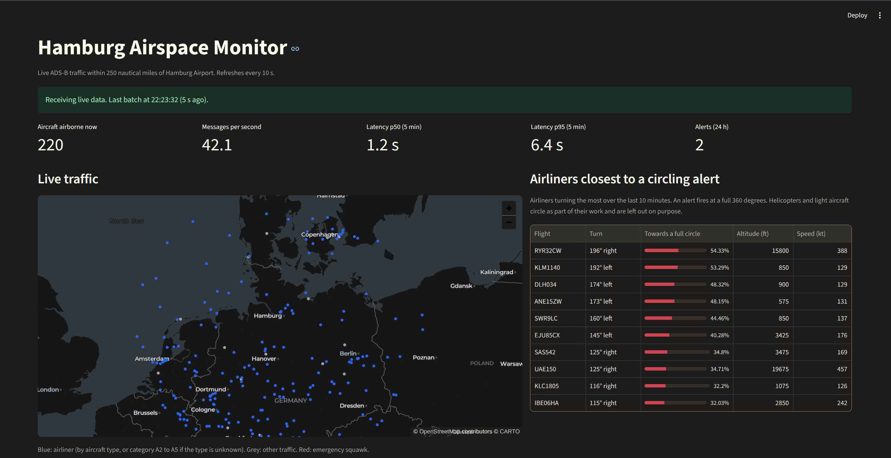
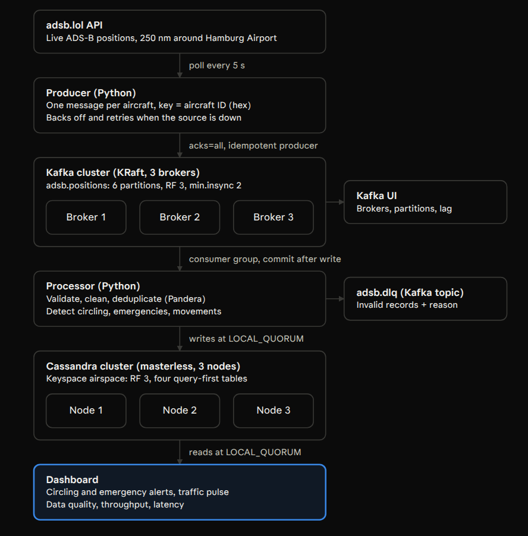
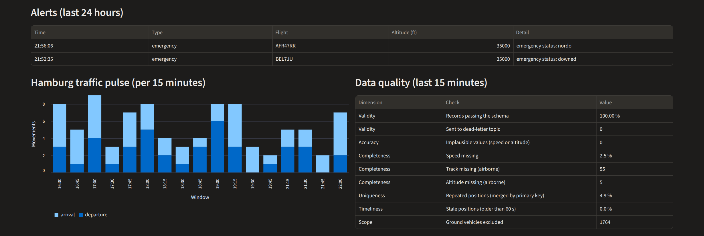
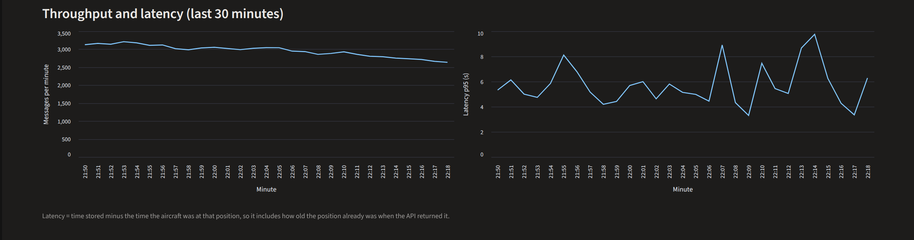
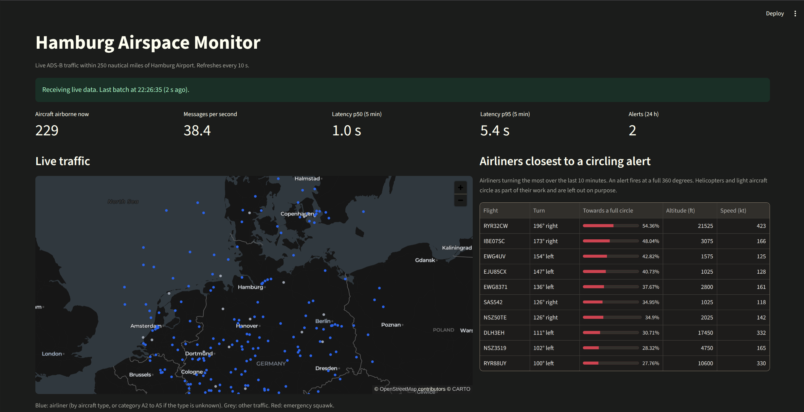
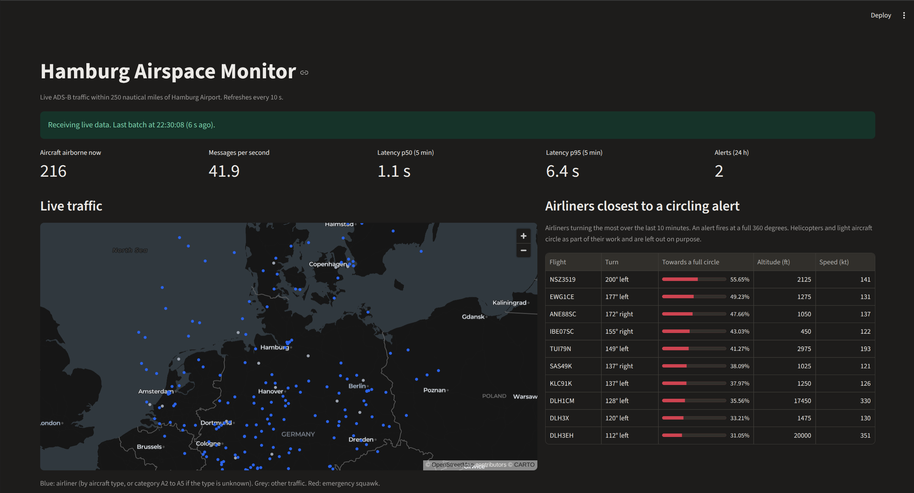
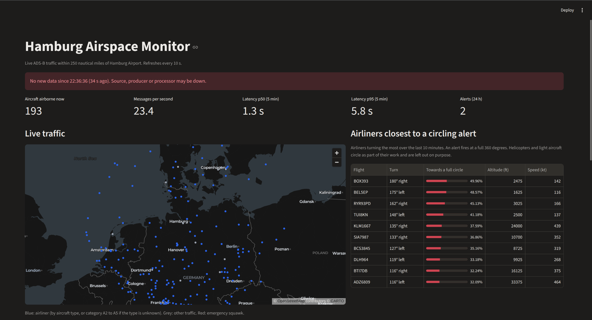
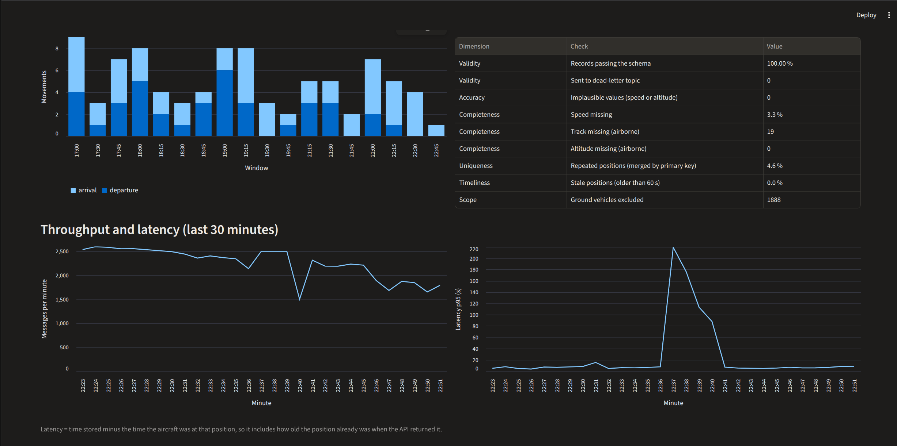

# Hamburg Airspace Monitor

A real-time streaming pipeline that watches live aircraft traffic within 250 nautical miles of Hamburg Airport and detects **airliners circling instead of landing** and **in-flight emergencies**, so airport and airline operations can react before delays cascade.

Live ADS-B positions flow through a 3-broker Apache Kafka cluster into a 3-node Apache Cassandra cluster and onto a Streamlit dashboard. The system keeps running, without losing data, when any single Kafka broker or Cassandra node fails.



Built as the final project for the Data Management course (stream processing, NoSQL, data quality).

## What it does

| Output | How it is produced |
| --- | --- |
| Circling alerts | An airliner whose ground track has turned a full 360 degrees within 10 minutes |
| Emergency alerts | Squawk 7500, 7600 or 7700, or an emergency status, confirmed in 3 positions within 2 minutes |
| Watchlist | The airliners currently closest to a full circle, updated on every refresh |
| Hamburg traffic pulse | Arrivals and departures at Hamburg Airport per 15 minutes |
| Data quality panel | Validity, accuracy, completeness, uniqueness and timeliness of the live stream |
| Pipeline health | Messages per second, latency (p50 and p95), and a warning when no new data arrives |

## Architecture



| Component | Technology | Job |
| --- | --- | --- |
| Producer | Python 3.12, confluent-kafka | Polls the adsb.lol API every 7 seconds and publishes one message per aircraft, keyed by aircraft ID |
| Message broker | Apache Kafka 4.4.0, KRaft, 3 brokers | Durable buffer: 6 partitions, replication factor 3, `min.insync.replicas=2` |
| Processor | Python 3.13, Pandera | Validates, cleans, stores, and detects circling, emergencies and airport movements |
| Database | Apache Cassandra 5.0.9, 3 nodes | Masterless storage: replication factor 3, reads and writes at `LOCAL_QUORUM` |
| Dashboard | Streamlit 1.67 | Reads only from Cassandra and refreshes every 10 seconds |
| Kafka UI | kafbat UI 1.5.0 | Brokers, topics, messages and consumer lag |

Design decisions and the alternatives that were rejected are in [docs/DECISIONS.md](docs/DECISIONS.md).

## Quick start

Requirements: Linux with Docker and the Docker Compose plugin, about 8 GB of free RAM, and internet access.

```bash
git clone https://github.com/RSNROXX/hamburg-airspace-monitor.git
cd hamburg-airspace-monitor

# Every Kafka cluster needs its own ID. Generate one into .env:
echo "KAFKA_CLUSTER_ID=$(docker run --rm apache/kafka:4.4.0 /opt/kafka/bin/kafka-storage.sh random-uuid)" > .env

docker compose up -d --build
```

The first start takes about 4 minutes, because the three Cassandra nodes join the cluster one after another. Check progress with `docker compose ps`: all Kafka and Cassandra containers should show `healthy`.

| What | Address |
| --- | --- |
| Dashboard | http://localhost:8501 |
| Kafka UI | http://localhost:8080 |

Stop everything with `docker compose down`. Stored data stays on Docker volumes. `docker compose down -v` also deletes the volumes and therefore all stored data.

## The dashboard





## Measured results

All figures come from runs on one laptop (32 CPU threads, 14 GB RAM) between 9 and 12 November 2026.

| Measure | Result |
| --- | --- |
| Throughput | 200 to 410 aircraft per poll depending on the time of day; about 61 messages per second at 309 aircraft |
| Latency | p50 1.3 to 1.5 s and p95 5.3 to 7.6 s from aircraft position to stored row |
| Reliability | 907,668 messages delivered with 0 failed in one continuous producer run, including a broker outage |
| Recovery | After the processor was stopped for 4.5 minutes, a backlog of about 10,000 messages was cleared in about 2.5 seconds |
| Memory | About 1.5 GB for 3 Kafka brokers and 2.8 GB for 3 Cassandra nodes |
| Tests | 29 offline tests for the rules, the batch logic and the dashboard |

## Failure tests

Each test was run against the live stream on 12 November 2026. Commands, expected behaviour and the real outputs are in [docs/RUNBOOK.md](docs/RUNBOOK.md).

| Scenario | Result | Data lost |
| --- | --- | --- |
| One Kafka broker stopped | Producer and processor continued; every message still confirmed by 2 replicas | None |
| One Cassandra node stopped | Processor kept writing at QUORUM (2 of 3); the node caught up after restart | None |
| Processor stopped for 4.5 minutes | Dashboard warned within 30 seconds; Kafka held the backlog; the processor caught up after restart | None, only delayed |
| Processor process ended | Docker restarted the container within seconds | None |
| Source rate limit (HTTP 429) | Producer backed off and retried; the poll interval was then raised from 5 to 7 seconds | None |

With one Kafka broker down, the dashboard keeps receiving data:



With one Cassandra node down:



With the processor stopped, the dashboard says so instead of showing old data as live:



After the restart, throughput shows no hole and latency shows the backlog draining:



## What the real data taught me

Three rules were wrong in their first version, and the live stream showed it.

1. **Circling.** The first 10 circling alerts were all helicopters and light aircraft, which circle as part of their work. Alerts are now limited to airliners.
2. **Aircraft category.** The transponder category is set by hand and is sometimes wrong: one Airbus A321 broadcast "no category". Airliners are now identified by aircraft type first and by category only as a fallback.
3. **Emergencies.** Single corrupted radio messages produced false "unlawful interference" and "downed" alerts for normal flights. An emergency alert now needs the same signal in 3 positions within 2 minutes.

The before and after evidence is in [docs/evidence](docs/evidence).

## Data quality

The processor checks every batch and the dashboard reports the results by quality dimension.

| Dimension | Check |
| --- | --- |
| Validity | Pandera schema: aircraft ID format, coordinates on Earth, numeric types. Failures go to the dead-letter topic `adsb.dlq` with the reason |
| Accuracy | Speed and altitude within physical limits |
| Completeness | Missing speed, track or altitude |
| Uniqueness | Repeated positions between polls are merged by the primary key |
| Timeliness | Positions older than 60 seconds are flagged as stale |
| Consistency | Altitude arrives as a number or the text "ground"; it is split into `on_ground` and a numeric altitude |

## Project structure

```
docker-compose.yml       all services, health checks, volumes
producer/                polls adsb.lol and publishes to Kafka
processor/
  rules.py               cleaning, validation and detection rules (no Kafka, no Cassandra)
  processor.py           Kafka consumer loop and Cassandra writes
  tests/                 offline tests
dashboard/
  data.py                Cassandra queries
  app.py                 Streamlit page
  tests/                 offline tests
infra/
  kafka/                 topic creation script
  cassandra/             keyspace and tables (CQL)
docs/
  DECISIONS.md           design decisions and rejected alternatives
  RUNBOOK.md             failure scenarios with commands and observed results
  evidence/              raw outputs from tests
  images/                screenshots
PROMPTS.md               AI prompts used during development (course requirement)
```

## Running the tests

The services run in containers. A local virtual environment is only needed for the tests.

```bash
python3 -m venv .venv
source .venv/bin/activate
pip install -r processor/requirements.txt -r dashboard/requirements.txt pytest
python -m pytest processor/tests dashboard/tests
```

## Configuration

Settings are environment variables in `docker-compose.yml`.

| Setting | Default | Meaning |
| --- | --- | --- |
| `CENTER_LAT`, `CENTER_LON` | 53.63, 9.99 | Centre of the monitored area (Hamburg Airport) |
| `RADIUS_NM` | 250 | Radius in nautical miles (the API maximum) |
| `POLL_INTERVAL_S` | 7 | Seconds between polls; the source allows about 10 requests per minute |
| `REFRESH_S` | 10 | Dashboard refresh in seconds |

Scale the processor with `docker compose up -d --scale processor=3`. Up to 6 instances can share the 6 partitions.

## Limitations

- All brokers and nodes run on one machine, as a simulation of a distributed cluster. In production each would run on its own machine and rack.
- If the producer itself fails, positions it had not yet delivered are lost, because the source only offers current positions. The gap is a few seconds.
- The source is polled, not pushed, and is rate limited. Coverage depends on volunteer receivers.
- The airliner type list is maintained by hand and covers the common Airbus, Boeing, Embraer, Bombardier, ATR and Dash 8 types.
- No authentication or encryption between services. Ports are published on localhost only.

## Data source

Aircraft positions come from [adsb.lol](https://adsb.lol), a community-run ADS-B network that provides its data free of charge.
