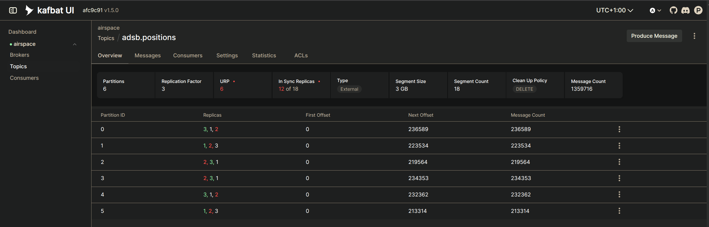
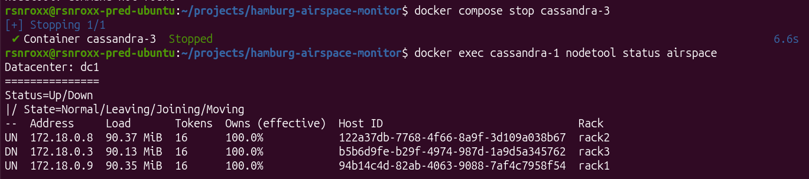
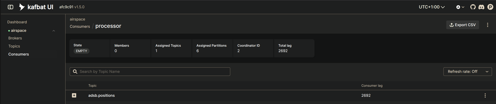
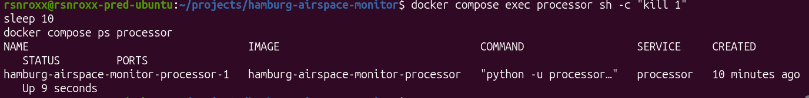

# Runbook: failure scenarios

How to trigger each failure, what the system should do, what it actually did, and how to recover.

All commands run from the project folder. Tests marked "observed" were run against the live stream on 12 November 2026. Times in the outputs are UTC (local time was UTC+1). Outputs are shortened: repeated lines, extra spaces and unused columns are removed, and `...` marks cut text.

Useful checks at any time:

```bash
docker compose ps
docker compose logs --tail 5 producer
docker compose logs --tail 5 processor
docker exec cassandra-1 nodetool status airspace
docker exec -e KAFKA_HEAP_OPTS=-Xmx128m kafka-1 /opt/kafka/bin/kafka-topics.sh --bootstrap-server kafka-1:19092 --describe --topic adsb.positions
docker exec -e KAFKA_HEAP_OPTS=-Xmx128m kafka-1 /opt/kafka/bin/kafka-consumer-groups.sh --bootstrap-server kafka-1:19092 --describe --group processor
```

## 1. One Kafka broker fails (observed)

**Trigger**

```bash
docker compose stop kafka-2
```

**Expected.** Partitions led by broker 2 get a new leader from the in-sync replicas. Two replicas remain, which meets `min.insync.replicas=2`, so writes continue. The dashboard stays green.

**Observed.** Producer and processor continued without a gap:

```
producer  | 2026-11-12 21:27:23,234 INFO Poll 1794518843001: 255 aircraft sent, 0 not yet confirmed (total delivered 907668, failed 0)
producer  | 2026-11-12 21:27:28,288 INFO Poll 1794518848001: 256 aircraft sent, 0 not yet confirmed (total delivered 907924, failed 0)
processor-1  | %6|1794518745.954|FAIL|rdkafka#consumer-1| [thrd:kafka-2:19092/2]: kafka-2:19092/2: Disconnected: connection closed by peer
processor-1  | 2026-11-12 21:27:23,793 INFO Batch: 255 in, 250 stored, 0 to DLQ, 5 ground vehicles, 0 alerts, 0 movements
```



**Recover**

```bash
docker compose start kafka-2
```

The broker catches up and rejoins the in-sync replicas. Kafka hands leadership back within 5 minutes. A first test of this cycle, without live data, is in [evidence/failover-2026-11-09.md](evidence/failover-2026-11-09.md).

## 2. One Cassandra node fails (observed)

**Trigger**

```bash
docker compose stop cassandra-3
```

**Expected.** Two of three replicas still answer, which is a quorum, so reads and writes at `LOCAL_QUORUM` continue. The other nodes store hints for the missing node.

**Observed.** One node down, two up, processor still storing:

```
--  Address     Load       Tokens  Owns (effective)  Host ID                               Rack
UN  172.18.0.8  90.37 MiB  16      100.0%            122a37db-7768-4f66-8a9f-3d109a038b67  rack2
DN  172.18.0.3  90.13 MiB  16      100.0%            b5b6d9fe-b29f-4974-987d-1a9d5a345762  rack3
UN  172.18.0.9  90.35 MiB  16      100.0%            94b14c4d-82ab-4063-9088-7af4c7958f54  rack1
```

```
processor-1  | 2026-11-12 21:28:42,315 WARNING Host 172.18.0.3:9042 has been marked down
processor-1  | 2026-11-12 21:28:45,668 INFO Batch: 253 in, 247 stored, 0 to DLQ, 6 ground vehicles, 0 alerts, 0 movements
```



**Recover**

```bash
docker compose start cassandra-3
```

After about a minute all three nodes showed `UN` again, and the restarted node's load had grown from 90.13 to 91.09 MiB as it received the writes it had missed.

## 3. The processor stops, then catches up (observed)

**Trigger**

```bash
docker compose stop processor
```

**Expected.** The producer keeps delivering and Kafka keeps the messages. The dashboard warns that no new data is arriving. After a restart the processor continues from its last committed offset and clears the backlog.

**Observed.** The dashboard turned red within about 30 seconds. After 4.5 minutes the backlog was 9,598 messages:

```
Consumer group 'processor' has no active members.

GROUP      TOPIC           PARTITION  CURRENT-OFFSET  LOG-END-OFFSET  LAG
processor  adsb.positions  0          241538          243560          2022
processor  adsb.positions  1          227507          229144          1637
processor  adsb.positions  2          223808          225104          1296
processor  adsb.positions  3          238505          239977          1472
processor  adsb.positions  4          236137          237515          1378
processor  adsb.positions  5          218417          220210          1793
```



**Recover**

```bash
docker compose start processor
```

The processor read 20 batches of 500 messages in about 2.5 seconds and was back to live batches 7 seconds after starting:

```
processor-1  | 2026-11-12 21:36:36,752 INFO Processor stopped
processor-1  | 2026-11-12 21:41:10,983 INFO Processor started: adsb.positions -> Cassandra keyspace airspace (group processor)
processor-1  | 2026-11-12 21:41:11,198 INFO Batch: 500 in, 484 stored, 0 to DLQ, 16 ground vehicles, 0 alerts, 0 movements
processor-1  | 2026-11-12 21:41:13,484 INFO Batch: 500 in, 470 stored, 0 to DLQ, 30 ground vehicles, 0 alerts, 0 movements
processor-1  | 2026-11-12 21:41:18,707 INFO Batch: 221 in, 209 stored, 0 to DLQ, 12 ground vehicles, 0 alerts, 0 movements
```

Afterwards the total lag was 177 messages, less than one poll. Nothing was skipped: the data was delayed, not lost. On the dashboard, latency for the affected minutes peaked at about 215 seconds and fell back to normal.

To catch up faster on a long backlog, add instances: `docker compose up -d --scale processor=3`.

## 4. The processor process ends (observed)

**Trigger**

```bash
docker compose exec processor sh -c "kill 1"
```

**Expected.** Docker restarts the container because of the restart policy `unless-stopped`.

**Observed.** The same container was running again 9 seconds later:

```
NAME                                   SERVICE     CREATED          STATUS
hamburg-airspace-monitor-processor-1   processor   10 minutes ago   Up 9 seconds
```



If the processor ends in the middle of a batch, the offsets of that batch were not committed, so it is read again. Every table is keyed so that a repeated write overwrites itself.

## 5. The source refuses requests (observed)

**Trigger.** None needed: at a 5-second poll interval, adsb.lol answered about one request per minute with HTTP 429.

**Expected.** The producer waits 1, 2, 4, 8 and up to 60 seconds between retries and continues when the source answers.

**Observed.** 32 warnings in 10 minutes, each followed by a successful poll:

```
producer  | 2026-11-12 21:43:55,855 WARNING Source unavailable (429 Client Error: Too Many Requests ...); retrying in 1 s
producer  | 2026-11-12 21:43:56,880 WARNING Source unavailable (429 Client Error: Too Many Requests ...); retrying in 2 s
producer  | 2026-11-12 21:43:58,900 WARNING Source unavailable (429 Client Error: Too Many Requests ...); retrying in 4 s
```

**Fix.** `POLL_INTERVAL_S` was raised from 5 to 7 seconds. After the change there were 0 warnings and one poll every 7 seconds. Evidence: [evidence/rate-limit-429-before-fix.txt](evidence/rate-limit-429-before-fix.txt) and [evidence/rate-limit-after-fix-7s.txt](evidence/rate-limit-after-fix-7s.txt).

A complete source outage behaves the same way: warnings in the producer log, and the dashboard reports that no new data has arrived.

## 6. Leadership is unbalanced after a restart (observed)

**Symptom.** After `docker compose up`, one broker leads all partitions, because it was ready first.

**Fix.** The topic script now triggers a preferred leader election on every start. To do it by hand:

```bash
docker exec -e KAFKA_HEAP_OPTS=-Xmx128m kafka-1 /opt/kafka/bin/kafka-leader-election.sh --bootstrap-server kafka-1:19092 --election-type preferred --all-topic-partitions
```

## Scenarios expected by design, not tested live

| Scenario | Expected behaviour |
| --- | --- |
| Two Kafka brokers down | Only one replica remains, below `min.insync.replicas=2`. Kafka refuses writes rather than risk losing them. The producer retries. Confirmed data stays safe |
| Two Cassandra nodes down | A quorum is impossible. The processor fails its writes, exits without committing, is restarted by Docker and reads the same batch again once the nodes return |
| The producer fails | Docker restarts it. Positions it had fetched but not delivered are lost, a gap of a few seconds |
| The whole machine loses power | Everything stops. Kafka and Cassandra data is on Docker volumes and is read again at the next start |
